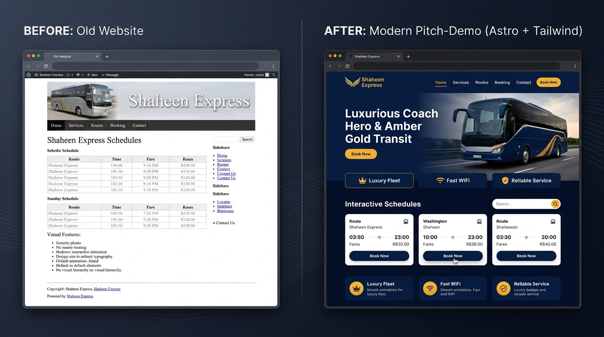

# Shaheen Express — Modern Pitch-Demo Website

> High-performance, luxury pitch-demo website for **Shaheen Express** (Kohat-based intercity bus service), built with **Astro 5** and **Tailwind CSS**.
> 
> 🌐 **Live Website**: [https://shaheen-express-phi.vercel.app](https://shaheen-express-phi.vercel.app)



---

## 🌟 Before vs After Comparison

| Feature | Legacy Site (`shaheenexpress.com.pk`) | New Astro + Tailwind Pitch-Demo |
| :--- | :--- | :--- |
| **Design & UI** | Dated WordPress theme, generic styling | Sleek transit navy (`#0B132B`) & falcon amber (`#E5A910`) |
| **Mobile UX** | Hard-to-read static desktop table | Responsive cards with one-tap dial buttons & sticky call bar |
| **Performance** | Heavy WordPress plugins, unoptimized PNGs | Pre-compiled static Astro HTML, WebP images, 0ms layout shift |
| **Sleeper Bus Showcase** | Hidden announcement text | Prominent dedicated visual showcase for Kohat–Lahore sleeper |
| **Stock Imagery** | None / mismatched | High-resolution photography for Onboard Amenities, WiFi, and Safety |
| **Routes & SEO** | Single page table | 15 static routes with OpenGraph, JSON-LD schema, and sitemap |

---

## 🚀 Key Features

1. **100% Verbatim Truth**: All headings, texts, stats, and phone numbers are sourced directly from the live site without alterations.
2. **Interactive Search & Schedules**: Instant client-side filtering for 7 daily routes and all regional terminals (Kohat, Pindi, Abbottabad, Gujranwala).
3. **One-Tap Direct Dial**: Clickable `tel:` and WhatsApp links for instant booking from mobile devices.
4. **Luxury Fleet Lightbox**: Zero-dependency vanilla JS lightbox with categorized filter tabs (Exterior Coaches, Sleeper Berths, Interiors).
5. **Data Issues Log**: Fully documented quirks from the live WordPress database in `DATA-ISSUES.md`.

---

## 🛠️ Tech Stack

- **Framework**: [Astro 5](https://astro.build/) (Static Site Generation)
- **Styling**: [Tailwind CSS](https://tailwindcss.com/)
- **Typography**: Plus Jakarta Sans & Inter
- **Images**: Responsive WebP with pre-generated thumbnails
- **SEO**: Dynamic OpenGraph meta tags, Twitter cards, and Schema.org `BusTrip` / `LocalBusiness` JSON-LD

---

## 📦 Getting Started

### 1. Clone & Install

```bash
git clone https://github.com/ATTIQSHAH/shaheen-express.git
cd shaheen-express
npm install
```

### 2. Run Locally

```bash
npm run dev
```

Visit `http://localhost:4321/` in your browser.

### 3. Production Build

```bash
npm run build
npm run preview
```

---

## 📄 License & Attribution

- Brand content and route information © Shaheen Express.
- Pitch-demo redesign developed by **Attiq Shah**.
